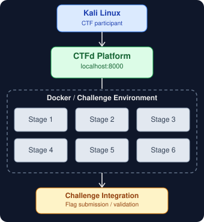
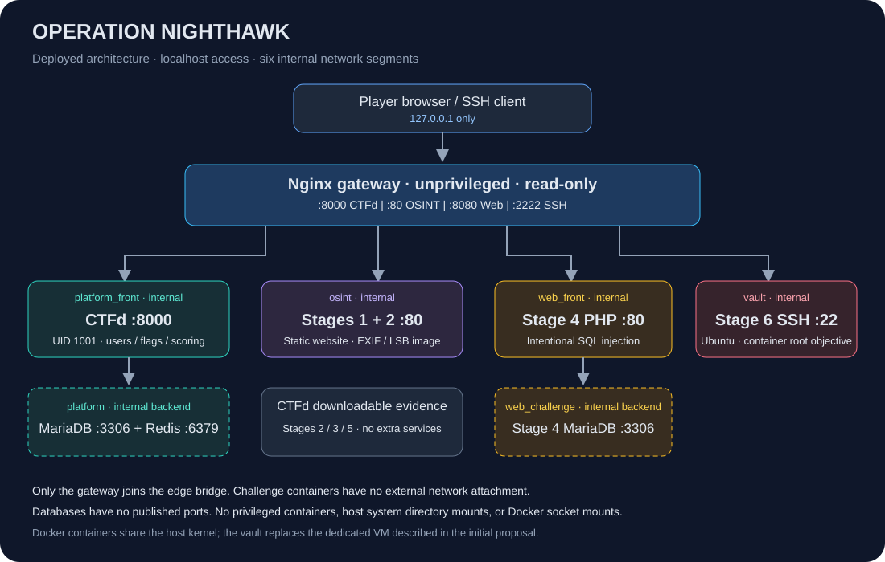

<div align="center">

# Operation NightHawk
### The GhostByte Files

**Six stages. One compromised project. Follow the evidence.**

OSINT · Steganography · Cryptography · Web Security · Forensics · Reverse Engineering

</div>

GhostByte has compromised NexaCore Dynamics and stolen Project Prometheus. Players investigate a trail of image metadata, concealed messages, encrypted correspondence, a vulnerable portal, forensic evidence, and a protected Linux vault.

<p align="center"></p>

> The image above is a conceptual overview. The network diagram below documents the actual deployed services. File-based stages do not each have their own container.

## Start the box

Requirements: Linux, Docker Engine, Docker Compose v2 or later, Python 3, and a working Internet connection for the first image download/build. The tested host uses Docker Engine 26.1.5 and Compose 5.6.0. Docker access is required for the current user. Plan for about 4 GB of available RAM and 10 GB of disk space; actual usage is shown with `docker stats`.

```bash
<<<<<<< HEAD
cd /home/dineth/Desktop/operation_nighthawk
=======
cd /path/to/operation_nighthawk
>>>>>>> 6aae6dc (remaster)
./scripts/deploy.sh
```

For another computer, change into the directory where you extracted this project before running the script.

The deployer generates `.env` once, builds the challenge images, waits for health checks, and configures CTFd. Repeat deployment preserves existing secrets, admin passwords, player accounts, and scores. Challenge descriptions, flags, hints, prerequisites, and uploaded evidence are synchronized from this project.

| Service | Connection | Purpose |
|---|---|---|
| CTFd | http://localhost:8000 | Registration, challenges, flag submissions, scoreboard |
| Administration | http://localhost:8000/admin | Manage the competition |
| NexaCore website | http://localhost/ | Stages 1 and 2 |
| Shadow portal | http://localhost:8080/ | Stage 4 web challenge |
| Storage vault | `ssh -p 2222 runner@localhost` | Stage 6 |

**Admin credentials:** read `.local/admin-credentials.txt` on the deployment host. This file and `.env` are private, generated files; do not commit or include them in a public submission package. No shared default CTFd admin password is embedded in the source.

All published connections bind to `127.0.0.1`. Open the browser on the same computer as Docker. A different laptop cannot connect using its own `localhost`.

<<<<<<< HEAD
## Manual deployment

```bash
python3 scripts/init_env.py
docker compose up -d --build --wait --wait-timeout 240
python3 scripts/setup_ctfd.py
docker compose ps
```

The last Python command performs the admin and challenge setup automatically. To configure a completely new instance by hand instead, omit that command and visit `/setup`; use the CTFd admin interface to enter the six challenge records from `ctfd/challenges.json`. An already configured instance opens the home page instead of the setup wizard.

Use the root Compose file. The Compose files under `ctfd/` and `stage4_web/` are compatibility entry points that include this same full project.

## Play the investigation

=======
## Set up a shared copy on a new computer

Sharing the project folder shares the source files, not the Docker database or CTFd setup state. Each computer gets its own database volumes. On a fresh computer, run the project deploy script once from the project folder so it creates local secrets, starts the services, and loads the custom homepage and six challenges:

```bash
cd /path/to/operation_nighthawk
./scripts/deploy.sh
```

Then open http://localhost:8000. The first-run CTFd setup page should be replaced by the Operation NightHawk homepage. The new computer's private admin login is saved in `.local/admin-credentials.txt`. Do not copy another computer's `.env` or Docker database volumes.

If the containers are already running and CTFd still shows its setup page, run the bootstrap step from the project folder:

```bash
python3 scripts/setup_ctfd.py
```

This uses the local `.env` values and configures the homepage, admin, flags, challenge order, hints, and downloadable evidence. If `.env` does not exist, run `./scripts/deploy.sh` instead; it generates the settings first.

## Manual deployment

```bash
python3 scripts/init_env.py
docker compose up -d --build --wait --wait-timeout 240
python3 scripts/setup_ctfd.py
docker compose ps
```

The last Python command performs the admin and challenge setup automatically. To configure a completely new instance by hand instead, omit that command and visit `/setup`; use the CTFd admin interface to enter the six challenge records from `ctfd/challenges.json`. An already configured instance opens the home page instead of the setup wizard.

Use the root Compose file. The Compose files under `ctfd/` and `stage4_web/` are compatibility entry points that include this same full project.

## Play the investigation

>>>>>>> 6aae6dc (remaster)
1. Open http://localhost:8000/register in an incognito window.
2. Register a separate player account; use your admin account only for administration.
3. Open **Challenges**, then **1. The Digital Footprint**.
4. Follow the challenge description and collect a flag in the format `NH{...}`.
5. Submit the flag to earn points and unlock the next stage.

| Stage | Challenge | Domain | Difficulty | Points | Player material |
|---|---|---|---|---:|---|
| 1 | The Digital Footprint | OSINT | Easy | 100 | Team roster and employee image |
| 2 | The Hidden Message | Steganography | Easy | 100 | `trophy.png` |
| 3 | Encrypted Correspondence | Cryptography | Moderate | 200 | `chat_log.txt` |
| 4 | The Backdoor Portal | Web security | Moderate | 200 | PHP authentication portal |
| 5 | Tracing the Exfiltration | Forensics / networking | Moderate–Hard | 300 | `exfil.pcap` and `disk.img` |
| 6 | The Prometheus Vault | Reverse engineering / privilege escalation | Hard | 400 | SSH storage node |

Total: **1,300 points**. Each challenge has a free hint. Static flags are case-sensitive; duplicate solves do not earn additional points. Stages unlock sequentially, including their CTFd evidence downloads.

Solutions and exact flags are organizer material in [WALKTHROUGH_AND_SOLUTIONS.md](WALKTHROUGH_AND_SOLUTIONS.md). The source package contains answers for reproducibility; give players the running services and challenge downloads rather than the organizer source tree.

## Architecture as deployed



Eight containers run across seven bridge networks. Only the gateway joins the non-internal `edge` network. It proxies HTTP and SSH to services on internal networks. CTFd uses a separate backend network for its database and Redis; the web challenge uses its own backend database network.

| Network | Attached services | Internal |
|---|---|---|
| `edge` | Gateway | No; localhost ports terminate here |
| `platform_front` | Gateway, CTFd | Yes |
| `platform` | CTFd, CTFd MariaDB, Redis | Yes |
| `osint` | Gateway, static website | Yes |
| `web_front` | Gateway, Stage 4 PHP | Yes |
| `web_challenge` | Stage 4 PHP, Stage 4 MariaDB | Yes |
| `vault` | Gateway, Stage 6 SSH | Yes |

The gateway routes connections; CTFd validates answers and stores scores. CTFd does not provision a separate challenge instance for every player. The web portal and vault are shared challenge services.

Controls implemented:

- Database and Redis ports are not published.
- Challenge containers have no external network attachment.
- CTFd runs as UID 1001; the gateway runs as UID 101.
- Gateway drops all capabilities, uses a read-only filesystem, and disallows new privileges.
- Stage 1 uses a read-only filesystem. Stage 4 application code is copied into its image.
- No service uses privileged mode, host networking, or a Docker socket mount.
- CPU-process count and memory limits are configured; container logs rotate at 10 MB, with three files retained.
- CTFd secrets are generated per deployment and preserved across restarts.

Stage 6 intentionally permits its `runner` user to escalate to root inside that container. It does not use `no-new-privileges`, because that would prevent the intended sudo challenge. Docker containers share the host kernel; this is an educational local lab, not a dedicated VM boundary.

### Changes from the initial proposal

- Stage 6 uses an Ubuntu 22.04 container in place of a dedicated VirtualBox VM, allowing the whole submitted box to run through Compose.
- Nginx provides one local gateway because this host's Docker configuration did not publish ports for services attached only to internal networks.
- The original shared network is split into platform, challenge frontend, and backend networks.
- Stages 2, 3, and 5 use downloadable artifacts rather than additional running services.

### Challenge limitations

Stage 3 reveals reusable portal credentials as well as the SQL injection clue. Both routes reach the existing Stage 4 flag. Stage 5 is a small synthetic evidence set that supports string carving. Stage 6's binary can decrypt the vault directly after privilege escalation. These are current implementation choices; do not claim that they enforce a mandatory complex exploit or mandatory reverse engineering path.

## Validate the complete box

Install the validation dependencies into a virtual environment if they are not already present:

```bash
python3 -m venv .local/venv
.local/venv/bin/pip install -r requirements-validation.txt
.local/venv/bin/python scripts/validate.py
```

On the tested host, `python3 scripts/validate.py` also works with the existing Python packages. OpenSSH client is required for the vault test.

The validator logs in as admin, registers a temporary player, tests prerequisite rejection, recovers all six flags from artifacts and live services, submits incorrect and correct flags, checks uploaded evidence, verifies the 1,300-point score, tests duplicate submissions, and inspects isolation controls. It connects to Stage 6 by SSH and uses the intended sudo-find path. It deletes its temporary player and their submissions afterward.

Results are saved to `evidence/validation.json`; failures return a nonzero exit status. `scripts/test_solves.sh` invokes this live validator. Test outputs may show recovered flags through challenge service logs, so keep evidence within the organizer package.

## Stop, restart, and reset

Stop without deleting persistent data:

```bash
docker compose down
```

Start the configured box again:

```bash
./scripts/deploy.sh
```

Restore the challenge database and challenge container filesystems:

```bash
./scripts/reset.sh challenges
```

This deletes Stage 4 database changes and recreates the website, portal, and vault containers. It preserves CTFd accounts, solves, scores, and uploads. Files distributed by CTFd are refreshed by `python3 scripts/setup_ctfd.py`.

For a completely fresh competition, `docker compose down -v` deletes this project's database, uploads, Redis, and log volumes, including all player accounts and scores. Only use it when you intend to erase that competition. Run `./scripts/deploy.sh` afterward; the existing `.env` supplies the same configured admin credentials.

## Inspect and troubleshoot

```bash
docker compose ps
docker compose logs --tail 50 ctfd gateway stage4_web
docker stats --no-stream
docker network ls --filter name=nighthawk-member1
```

| Symptom | Check |
|---|---|
<<<<<<< HEAD
| Port already in use | Stop the old NightHawk deployment that owns ports 80, 8000, 8080, or 2222. Do not remove unrelated Docker projects. |
=======
| Port already in use | `scripts/preflight.sh` reports which Docker container has a required port. Stop only the old lab container that owns it, then rerun `./scripts/deploy.sh`. For a host process, inspect it with the shown `ss` command. |
| CTFd shows the first-run setup page | From the project folder run `./scripts/deploy.sh`; if containers are already running and `.env` exists, run `python3 scripts/setup_ctfd.py`. |
| Teammate sees an empty CTFd | Each computer has separate Docker database volumes. Run `./scripts/deploy.sh` on that computer to configure its local instance. |
>>>>>>> 6aae6dc (remaster)
| CTFd does not open | Check gateway and CTFd health and logs; use `http://localhost:8000`. |
| Only Stage 1 can be opened | Expected for a new player; solve it to unlock Stage 2. |
| Portal reports a database problem | Check `stage4_db` health. PHP connects to `stage4_db`, not the CTFd database. |
| Admin login fails | Use the generated credentials file. Redeploying preserves an existing admin password. |
| Changed evidence still looks old | Run `python3 scripts/setup_ctfd.py` to refresh uploads. |

## Project layout

```text
ctfd/challenges.json             Canonical challenge descriptions, flags, hints, and files
<<<<<<< HEAD
 docker-compose.yml              All services, networks, volumes, and health checks
 gateway/nginx.conf              Local HTTP and SSH routing
 scripts/deploy.sh               Repeatable deployment
=======
docker-compose.yml               All services, networks, volumes, and health checks
 gateway/nginx.conf              Local HTTP and SSH routing
 scripts/deploy.sh               Repeatable deployment
 scripts/preflight.sh            Host port conflict check
>>>>>>> 6aae6dc (remaster)
 scripts/init_env.py             Initial secret generation
 scripts/setup_ctfd.py           Host-side bootstrap runner
 scripts/bootstrap_ctfd.py       CTFd configuration and artifact synchronization
 scripts/validate.py             Live platform and challenge validation
 scripts/reset.sh                Challenge-state recovery
 stage1_osint/                   Static site and EXIF evidence
 stage2_stego/                   LSB image and extractor
 stage3_crypto/                  Encrypted correspondence and solver
 stage4_web/                     PHP portal, Dockerfile, and database seed
 stage5_forensics/               Synthetic capture, disk image, and solver
 stage6_vault/                   SSH image, sudo challenge, and XOR vault
 docs/assets/                    Supplied overview and deployed network diagram
 evidence/                       Local build and validation results
```

## Member 1 contribution and demonstration

Deployment, platform configuration, network segmentation, local gateway, flag validation, logging, resource limits, and recovery are the Member 1 components. Inspect and understand the automation before presenting it. Show live deployment, the running admin/player views, one rejected and one accepted flag, network controls, resource usage, and recovery. Do not read this README as a video script or claim unperformed tests.

The assignment requires the recording to use your own explanation and prohibits AI assistance during the demonstration. This project was modified with AI coding assistance; represent contribution and understanding honestly.

## Acknowledgments

- [CTFd installation documentation](https://docs.ctfd.io/docs/deployment/installation/) and CTFd 3.8.8 container image.
- [CTFd challenge configuration](https://docs.ctfd.io/tutorials/challenges/creating-challenges/).
- [Docker networking documentation](https://docs.docker.com/engine/network/) and Docker Compose.
- Nginx, MariaDB 10.11, Redis 7, PHP 8.2, Ubuntu 22.04, OpenSSH, Pillow, and Requests.
- Project-owner supplied overview SVG is preserved at `docs/assets/download-source.svg`; the README uses a dark-background version at `docs/assets/overview.svg` for readability.
- Existing NightHawk challenge assets and story supplied by the project team.
