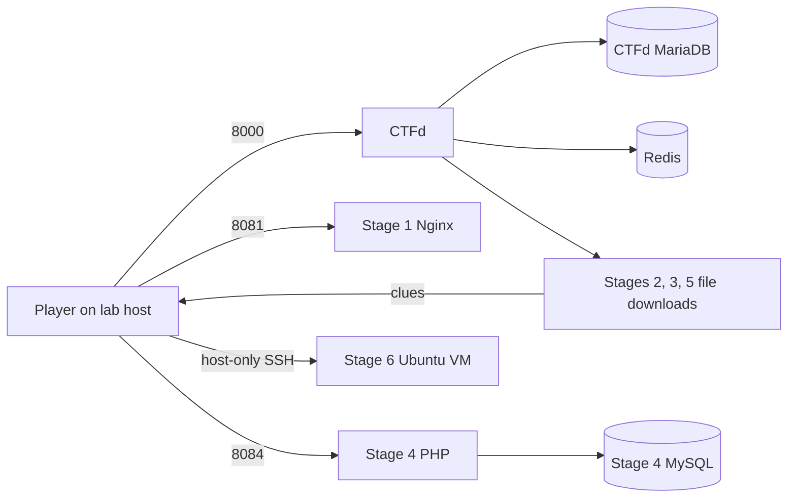

# As-built architecture and design choices

CTFd is the **scoreboard**: it shows descriptions, hosts downloads, checks
submitted flags, and records scores. It is not the vulnerable target. Stage 1
is a static Nginx site; Stages 2, 3, and 5 are downloadable files; Stage 4 is
an intentionally vulnerable PHP application with its own MySQL database; Stage
6 is an isolated Ubuntu VM with SSH and a small set-user-ID binary.

| Component | Access from lab host | Sensitive backend |
| --- | --- | --- |
| CTFd | 127.0.0.1:8000 | separate MariaDB and Redis containers |
| Stage 1 | 127.0.0.1:8081 | none |
| Stage 4 | 127.0.0.1:8084 | separate MySQL container |
| Stage 6 VM | host-only VM IP:22 | root-owned flag file inside VM |
| Stage 6 rehearsal | 127.0.0.1:2226 | flag inside disposable container |

The new Stage 5 has two independent flags, one for network forensics and one
for disk forensics. This preserves the report's six-stage story while adding a
third authored challenge on the Challenge Design B side. Stage 5 evidence also
provides the final vault login and two-part recovery code, so the plot remains
progressive. Stage 6 requires both earlier evidence artifacts.

All Docker host ports bind only to `127.0.0.1`. Database ports are not published.
Docker's internal networks separate the databases from the host. This is not
the same as a proven air gap: the host itself may have internet, and published
ingress bridges are not marked internal even though masquerading is disabled.
For an assessed or shared session, use a
dedicated lab host and a host-only/offline network, then verify isolation.

The GitHub repository is organizer **source**, not a player release. Stage 1–4
source includes fixed flags and spoilers. The generated Stage 5–6 secrets are
ignored by Git, but players must never receive the whole repository. Send only
the CTFd URL, required local service addresses, and CTFd file downloads.
